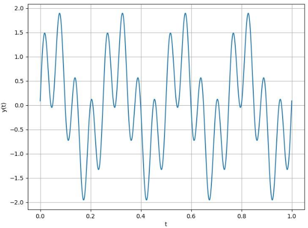
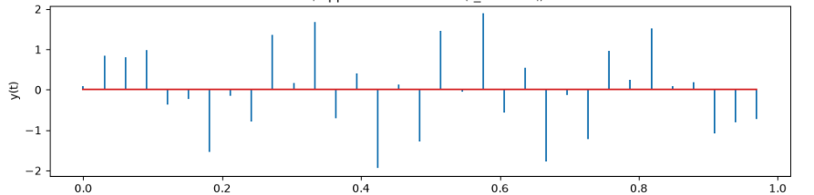
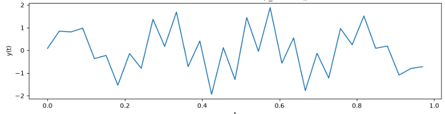
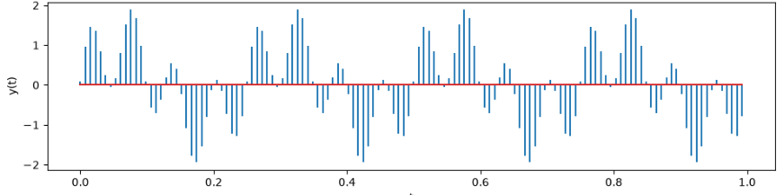
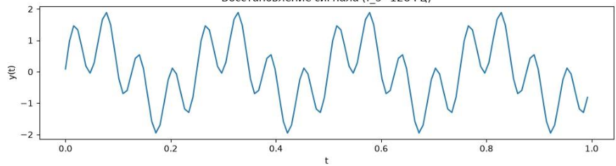
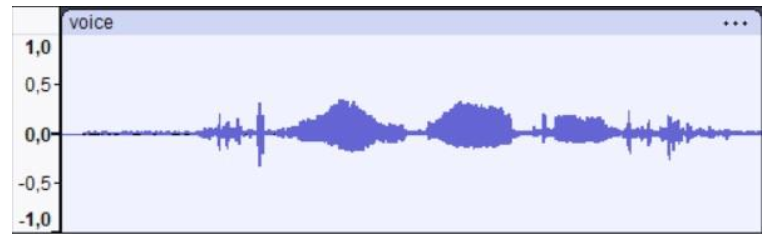
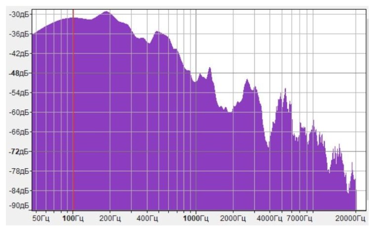
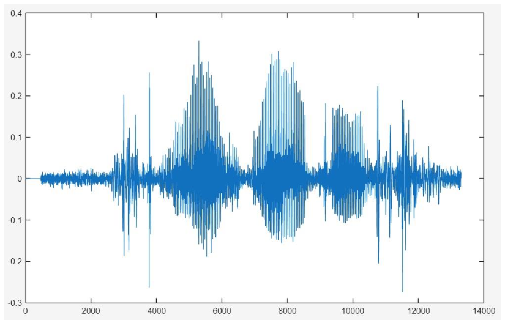

# Лабораторная работа №1: Временная и частотная формы сигналов. Преобразования Фурье. Дискретизация сигналов

## Исходные данные

- Сигнал по варианту: **y(t) = sin(2πft + π/36) + sin(8πft)**, **f = 4 Гц**, **T = 1 с**
- Инструменты: Python (**numpy**, **scipy**, **matplotlib**), MATLAB, Audacity

## Файлы

**1.py** – пункты 1–7 и 13

**script.m** – пункты 9–13

**voice.wav** – пункт 8 (запись голоса)

**images/lab1/** – скриншоты результатов

## Ход работы

### 1. Сигнал по варианту (пп. 1–3)

Построен непрерывный сигнал. Он состоит из двух гармоник: 4 Гц и 16 Гц, поэтому **f_max = 16 Гц**. По теореме Котельникова **f_д > 2·f_max = 32 Гц**.

### 2. Оцифровка с f_д = 32 Гц (пп. 4–6)

32 отсчёта на 1 с, массив **float64**: память **32 · 8 = 256 байт**, ширина спектра **0-16 Гц**. На граничной частоте отсчёты 16-герцовой гармоники попадают на нули синусоиды, поэтому восстановленный сигнал заметно отличается от оригинала.

### 3. Оцифровка с f_д = 128 Гц (п. 7)

Частота увеличена в 4 раза: 128 отсчётов, память **1024 байта**, спектр **0-64 Гц**. Восстановленный сигнал визуально близок к оригиналу.

### 4. Запись голоса (п. 8)

Голос записан в Audacity, спектр получен через . Максимальная частота по графику - около 20 кГц, значит нужна **f_д > 40 кГц**. Запись сделана с частотой 48 кГц.

### 5. Чтение файла и частота дискретизации (пп. 9–10)

В MATLAB: **[y, Fs] = audioread('voice.wav')**, **Fs = 48000 Гц**.

### 6. Прореживание (п. 11)

**y1 = downsample(y, 10)**, новая частота **Fs/10 = 4800 Гц**. Если воспроизводить **y1** с исходной частотой **Fs**, звук искажается.

### 7. Спектры оригинала и прореженного сигнала (п. 12)

Построены амплитудные спектры через **fft**.

### 8. Влияние разрядности АЦП (п. 13)

Отсчёты сигнала варианта (f_д = 128 Гц) округляются до **2^b - 1** уровней (для 3 бит - коды 0-7). Основные пики 4 и 16 Гц сохраняются.
