# Лабораторная работа №1: Временная и частотная формы сигналов. Преобразования Фурье. Дискретизация сигналов

## Исходные данные

- Сигнал по варианту:

$$
y(t) = \sin\left(2\pi f t + \frac{\pi}{36}\right) + \sin(8\pi f t)
$$

$$
f = 4 \text{ Гц}, \quad T = 1 \text{ с}
$$

- Инструменты: Python (**numpy**, **scipy**, **matplotlib**), MATLAB, Audacity

## Файлы

**1.py** - пункты 1-7 и 13

**script.m** - пункты 9-13

**images/lab1/** - скриншоты результатов

## Ход работы

### 1. Сигнал по варианту (пп. 1-3)

Построен непрерывный сигнал. Он состоит из двух гармоник: 4 Гц и 16 Гц, поэтому максимальная частота в спектре:

$$
f_{\max} = 16 \text{ Гц}
$$

По теореме Котельникова частота дискретизации должна превышать удвоенную максимальную. Выбрана ближайшая целая частота:

$$
f_{\text{д}} > 2 f_{\max} = 32 \text{ Гц}, \qquad f_{\text{д}} = 33 \text{ Гц}
$$

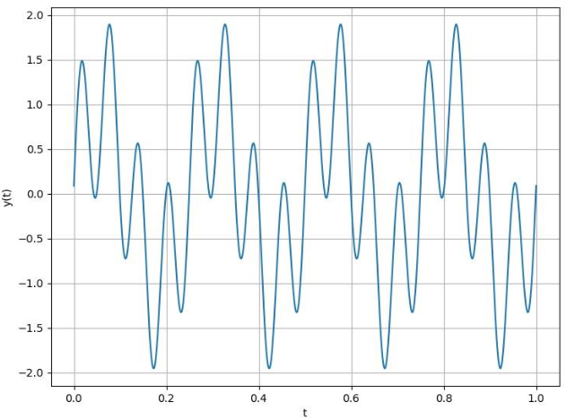

### 2. Оцифровка с f_д = 33 Гц (пп. 4-6)

33 отсчёта на 1 с, массив **float64**. Память для хранения:

$$
33 \cdot 8 = 264 \text{ байт}
$$

Ширина спектра:

$$
0 - \frac{f_{\text{д}}}{2} = 0 - 16{,}5 \text{ Гц}
$$

Разность максимального и минимального значений массива: 3,8264.

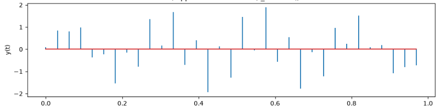
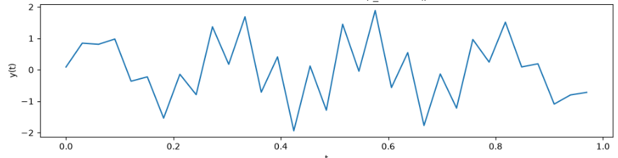

### 3. Оцифровка с f_д = 132 Гц (п. 7)

Частота увеличена в 4 раза:

$$
f_{\text{д}} = 4 \cdot 33 = 132 \text{ Гц}
$$

132 отсчёта, память и ширина спектра:

$$
132 \cdot 8 = 1056 \text{ байт}, \qquad 0 - 66 \text{ Гц}
$$

Разность максимального и минимального значений: 3,8264. Восстановленный сигнал визуально близок к оригиналу.

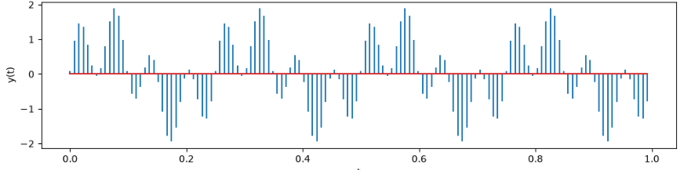
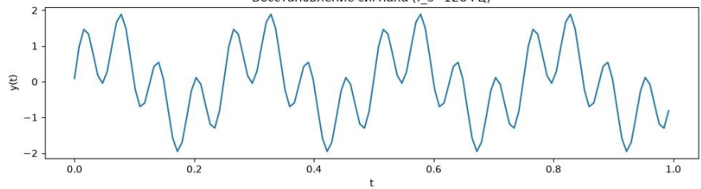

### 4. Запись голоса (п. 8)

Голос записан в Audacity. Максимальная частота по графику - около 20 кГц, значит:

$$
f_{\text{д}} > 2 \cdot 20 = 40 \text{ кГц}
$$

Запись сделана с частотой 48 кГц.

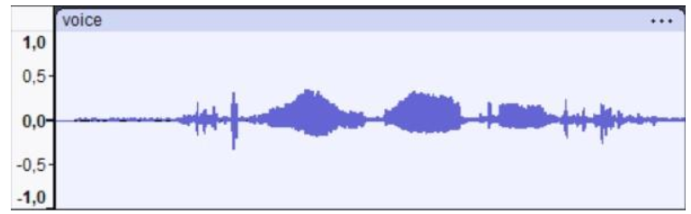
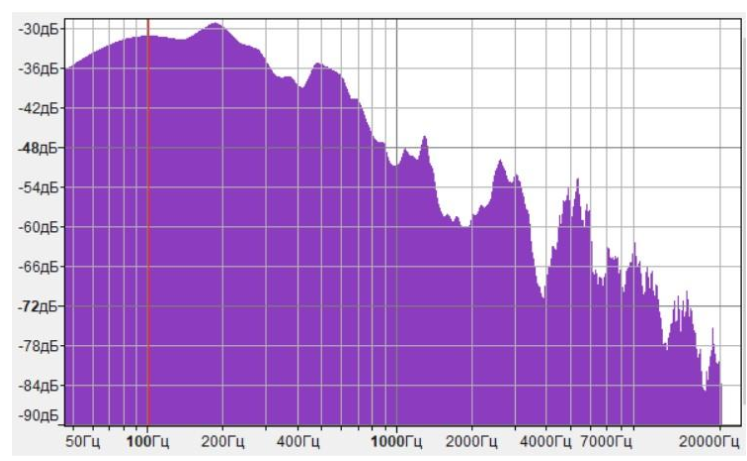

### 5. Чтение файла и частота дискретизации (пп. 9-10)

В MATLAB: **[y, Fs] = audioread('voice.wav')**, частота дискретизации из файла:

$$
F_s = 48000 \text{ Гц}
$$

Расчёт как отношение числа отсчётов к длительности записи (2,771 с):

$$
F_s = \frac{N}{t} \approx 48004 \text{ Гц}
$$

### 6. Прореживание (п. 11)

**y1 = downsample(y, 10)**, новая частота дискретизации и частота Найквиста:

$$
\frac{F_s}{10} = 4800 \text{ Гц}, \qquad \frac{4800}{2} = 2400 \text{ Гц}
$$

Если воспроизводить **y1** с исходной частотой **Fs**, звук искажается.

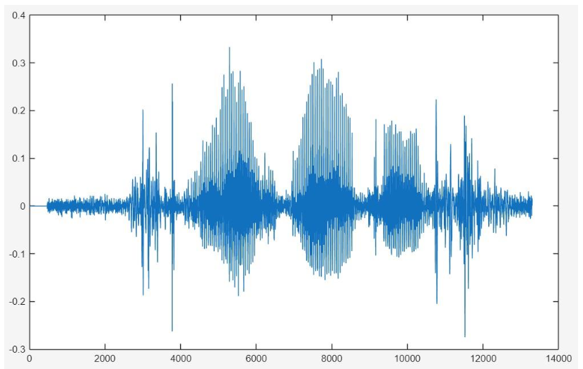

### 7. Спектры оригинала и прореженного сигнала (п. 12)

Построены амплитудные спектры через **fft**.

### 8. Влияние разрядности АЦП (п. 13)

Отсчёты сигнала варианта (f_д = 132 Гц) округляются до числа уровней:

$$
2^b - 1
$$

Для 3 бит это 0-7.

# Лабораторная работа №2: Бюджет канала связи и модели распространения сигнала

## Исходные данные

- Мощность передатчика БС: $P_{BS} = 46$ дБм
- Мощность передатчика UE: $P_{UE} = 24$ дБм
- Усиление антенны БС: $G_{BS} = 21$ дБи
- Потери в фидере: $L_{feeder} = 2 + 0.4 + 0.5 = 2.9$ дБ
- Выигрыш MIMO 2×2: $G_{MIMO} = 3$ дБ
- Запас на интерференцию: $IM = 1$ дБ
- Запас на проникновение: $L_{pen} = 15$ дБ
- Несущая частота: $f = 1800$ МГц ($1.8$ ГГц)
- Полоса UL: $BW_{UL} = 10$ МГц, полоса DL: $BW_{DL} = 20$ МГц
- Коэффициент шума БС: $NF_{BS} = 2.4$ дБ, UE: $NF_{UE} = 6$ дБ
- Требуемое SINR: $SINR_{UL} = 4$ дБ, $SINR_{DL} = 2$ дБ
- Высота антенны БС: $h_{BS} = 30$ м, UE: $h_{ms} = 1.5$ м
- Площадь макросот: $S_{macro} = 100$ км², микросот: $S_{micro} = 4$ км²
- Инструменты: Python (**numpy**, **matplotlib**)

## Файлы

**lab2.py** - расчёт бюджета канала, радиуса соты и построение графиков

**images/lab2/** - скриншоты результатов

## Ход работы

### 1. Бюджет восходящего канала (UL)

Тепловой шум в полосе UL:

$$N_{UL} = -174 + 10 \cdot \log_{10}(BW_{UL}) = -174 + 70 = -104 \text{ дБм}$$

Чувствительность приёмника БС:

$$RxSens_{BS} = NF_{BS} + N_{UL} + SINR_{UL} = 2.4 - 104 + 4 = -97.6 \text{ дБм}$$

Максимально допустимые потери:

$$MAPL_{UL} = P_{UE} - L_{feeder} + G_{BS} + G_{MIMO} - IM - L_{pen} - RxSens_{BS} = 126.7 \text{ дБ}$$

### 2. Бюджет нисходящего канала (DL)

Тепловой шум в полосе DL:

$$N_{DL} = -174 + 10 \cdot \log_{10}(BW_{DL}) = -174 + 73 = -101 \text{ дБм}$$

Чувствительность приёмника UE:

$$RxSens_{UE} = NF_{UE} + N_{DL} + SINR_{DL} = 6 - 101 + 2 = -93 \text{ дБм}$$

Максимально допустимые потери:

$$MAPL_{DL} = P_{BS} - L_{feeder} + G_{BS} + G_{MIMO} - IM - L_{pen} - RxSens_{UE} = 144.1 \text{ дБ}$$

### 3. Модели распространения сигнала

Построены зависимости потерь $PL(d)$ от расстояния для трёх моделей.

**UMiNLOS** (Urban Micro Non-Line-of-Sight):

$$PL(d) = 26 \cdot \log_{10}(f_{\text{ГГц}}) + 22.7 + 36.7 \cdot \log_{10}(d_{\text{м}})$$

**COST-231 Hata** (диапазон 1500-2000 МГц, $A = 46.3$, $B = 33.9$):

$$PL(d) = A + B \cdot \log_{10}(f) - 13.82 \cdot \log_{10}(h_{BS}) - a(h_{ms}) + s \cdot \log_{10}(d_{\text{км}}) + L_{clutter}$$

где 

$$a(h_{ms}) = 3.2 \cdot [\log_{10}(11.75 \cdot h_{ms})]^2 - 4.97$$

для городской застройки.

**Walfish-Ikegami** (LOS и NLOS):

$$L_{LOS} = 42.6 + 20 \cdot \log_{10}(f) + 26 \cdot \log_{10}(d)$$

$$L_{NLOS} = L_0 + \max(L_1 + L_2, 0), \quad L_0 = 32.44 + 20 \cdot \log_{10}(f) + 20 \cdot \log_{10}(d)$$

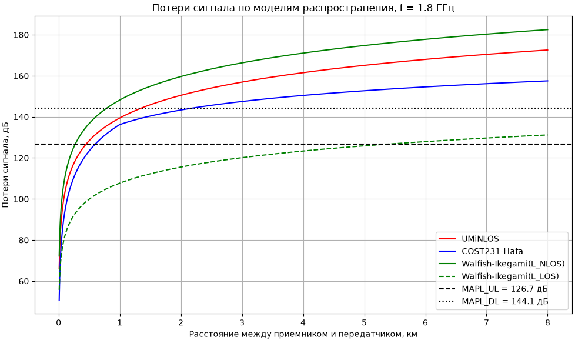

### 4. Радиус соты и количество базовых станций

Радиус находится аналитически из уравнения $MAPL = PL(R)$:

$$R = 10^{\frac{MAPL - C}{K}}$$

Площадь одной соты (3 сектора) и количество БС:

$$S = 1.95 \cdot R^2, \qquad N = \left\lceil \frac{S_{total}}{S} \right\rceil$$

**Результаты:**
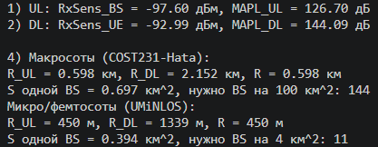

# Лабораторная работа №4: Корреляционные свойства последовательностей, используемых для синхронизации в сетях мобильной связи

## Исходные данные

- Номер по журналу: $N = 14$, группа с нечётным номером, поэтому используется схема на рис. 4.5
- Обратная связь регистра x: $x_4 \oplus x_5 \to x_1$, регистра y: $y_2 \oplus y_5 \to y_1$, выход: $x_5 \oplus y_5$
- Последовательность 1: $x = 14 = 01110$, $y = x + 7 = 21 = 10101$
- Последовательность 2: $x = 15 = 01111$, $y = 21 - 5 = 16 = 10000$
- Длина последовательности: $L = 2^5 - 1 = 31$
- Инструменты: C++, MATLAB (**xcorr**, **autocorr**)

## Файлы

**gold.cpp** - пункты 1-4 (генерация, автокорреляция, взаимная корреляция, проверка свойств)

**gold.m** - пункты 5-6 (расчёты и графики в Matlab)

**images/lab4/** - скриншоты результатов

## Ход работы

### 1. Генерация последовательностей Голда (пп. 1, 3)

Каждая последовательность формируется двумя пятиразрядными регистрами сдвига. На каждом такте содержимое сдвигается вправо, в первые ячейки записывается результат обратной связи, а выходной бит равен сумме по модулю 2 последних ячеек:

$$
x_1 \leftarrow x_4 \oplus x_5, \qquad y_1 \leftarrow y_2 \oplus y_5, \qquad \text{out} = x_5 \oplus y_5
$$

Выполнено 31 тактов для каждой пары начальных значений:

- последовательность 1: **1101101000101110000111101000011**
- последовательность 2: **1111101001100000110100110101011**

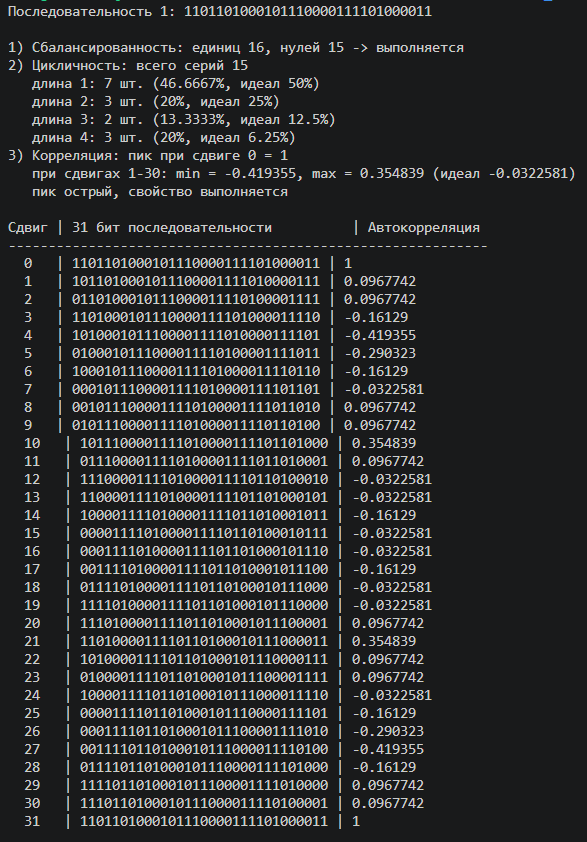
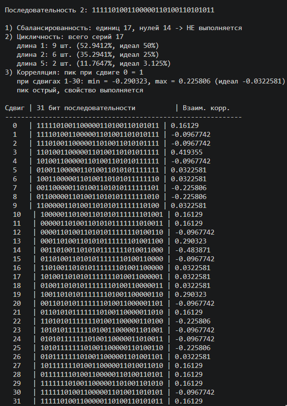

### 2. Проверка свойств псевдослучайной последовательности

Для обеих последовательностей программа проверяет три свойства: сбалансированность, цикличность (распределение серий одинаковых бит) и корреляцию.

**Последовательность 1:**

- единиц 16, нулей 15, сбалансированность выполняется
- всего 15 серий: длины 1 - 7 шт. (46,7 %), длины 2 - 3 шт. (20 %), длины 3 - 2 шт. (13,3 %), длины 4 - 3 шт. (20 %)
- пик автокорреляции при сдвиге 0 равен 1, при сдвигах 1-30 значения лежат от -0,4194 до 0,3548

**Последовательность 2:**

- единиц 17, нулей 14, сбалансированность не выполняется
- всего 17 серий: длины 1 - 9 шт. (52,9 %), длины 2 - 6 шт. (35,3 %), длины 5 - 2 шт. (11,8 %)
- пик автокорреляции при сдвиге 0 равен 1, при сдвигах 1-30 значения лежат от -0,2903 до 0,2258

Идеальное значение боковых лепестков для m-последовательности:

$$
R(\tau \neq 0) = -\frac{1}{L} = -\frac{1}{31} \approx -0{,}0323
$$

Полученные значения отличаются от идеальных. Причина в схеме рис. 4.5: обратная связь $x_4 \oplus x_5$ соответствует приводимому полиному

$$
x^5 + x^4 + 1 = (x^2 + x + 1)(x^3 + x + 1),
$$

поэтому регистр x не даёт последовательность максимальной длины, и идеальные свойства m-последовательности не достигаются. Пик при нулевом сдвиге при этом остаётся острым.

### 3. Автокорреляция и циклический сдвиг (п. 2)

Автокорреляция считается по формуле (4.3) при поэлементном циклическом сдвиге последовательности на $k$ позиций:

$$
R(k) = \frac{N_{\text{совп}} - N_{\text{несовп}}}{L}
$$

Результаты для последовательности 1:

- $R(0) = R(31) = 1$, так как сдвиг на период возвращает исходную последовательность
- максимум боковых значений 0,3548 при сдвигах 10 и 21
- минимум -0,4194 при сдвигах 4 и 27
- функция симметрична: $R(k) = R(31 - k)$

Острый пик при нулевом сдвиге позволяет использовать последовательность для обнаружения начала слота: приёмник сдвигает эталон по принятому сигналу и фиксирует максимум корреляции.

### 4. Взаимная корреляция (п. 4)

Взаимная корреляция исходной и второй последовательностей вычислена для всех циклических сдвигов:

$$
R_{12}(k) = \frac{N_{\text{совп}} - N_{\text{несовп}}}{L}
$$

- при сдвиге 0: $R_{12}(0) = 0{,}1613$
- максимум 0,4194 при сдвиге 3
- минимум -0,4839 при сдвиге 14

Все значения заметно меньше автокорреляционного пика (1), поэтому последовательности различимы. Для оптимальной пары кодов Голда длины 31 возможны только значения -1/31, -9/31 и 7/31. Часть полученных значений выходит за эти границы, то есть заданная пара не является оптимальной (следствие приводимости полинома регистра x).

### 5. Расчёты в Matlab (пп. 5-6)

Последовательности сформированы в Matlab для тех же начальных значений. Для расчёта корреляции они переведены в биполярный вид:

$$
s = 2g - 1 \quad (0 \to -1,\ 1 \to +1)
$$

Использованы функции:

- **xcorr(s, 'coeff')** - автокорреляция, нормированная на значение при нулевой задержке
- **autocorr(s', 'NumLags', 30)** - автокорреляция с вычитанием среднего
- **xcorr(s1, s2, 'coeff')** - взаимная корреляция

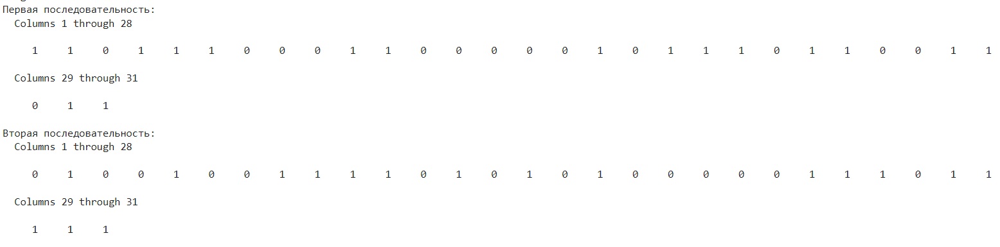
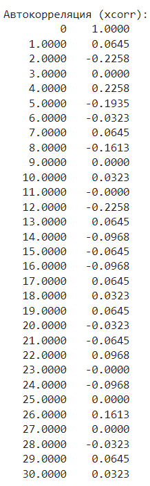
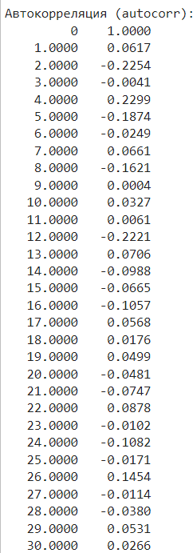
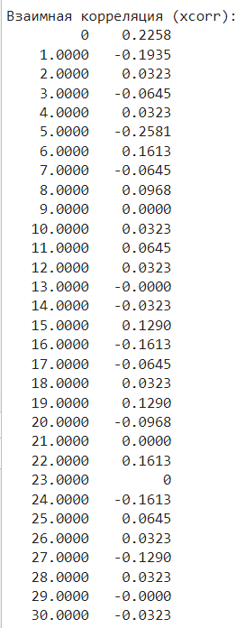

Автокорреляция в зависимости от величины задержки (lag):

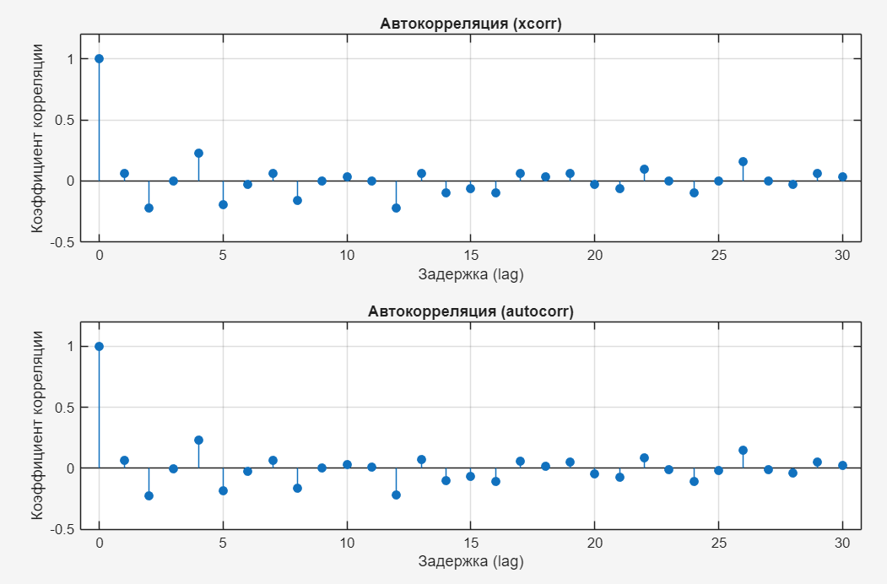

На графиках виден единичный пик при нулевой задержке и малые боковые значения. Графики xcorr и autocorr практически совпадают.

### 6. Сравнение Matlab и C++

Для последовательности 1 значения при первых сдвигах:

| Сдвиг | C++ | xcorr | autocorr |
|---|---|---|---|
| 1 | 0,0968 | 0,0645 | 0,0656 |
| 2 | 0,0968 | 0,0323 | 0,0353 |
| 3 | -0,1613 | -0,1290 | -0,1282 |
| 4 | -0,4194 | -0,3548 | -0,3543 |

Общий характер результатов совпадает: пик 1 при нулевом сдвиге и малые боковые значения. Числовые отличия объясняются двумя причинами:

1. В C++ сдвиг циклический, и на каждом сдвиге участвуют все 31 бит. Функции **xcorr** и **autocorr** считают линейную корреляцию: при задержке $k$ перемножается только $31 - k$ пар отсчётов.
2. Функция **autocorr** вычитает среднее значение сигнала, поэтому её результат немного отличается от **xcorr**.

Для периодической последовательности корректнее циклическая корреляция, поэтому именно она даёт значения, по которым оцениваются свойства последовательности.
