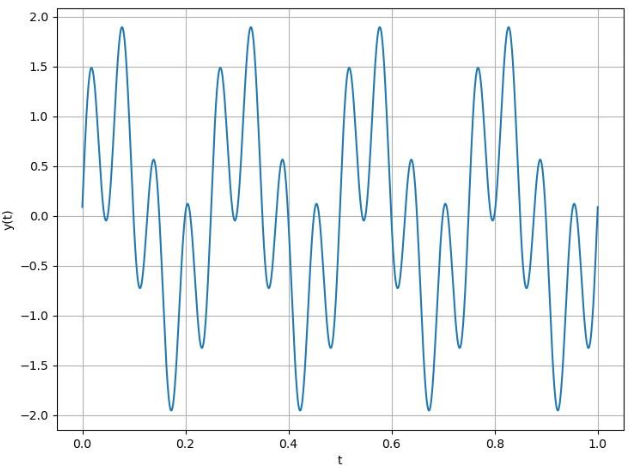
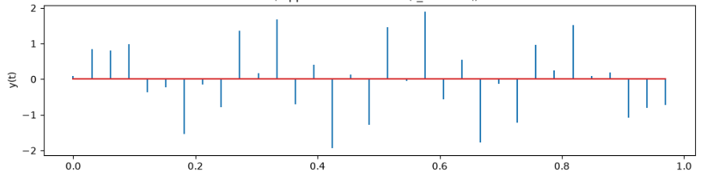
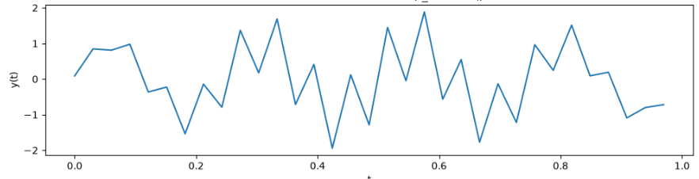
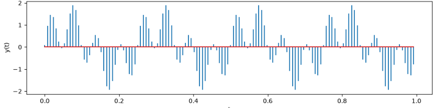
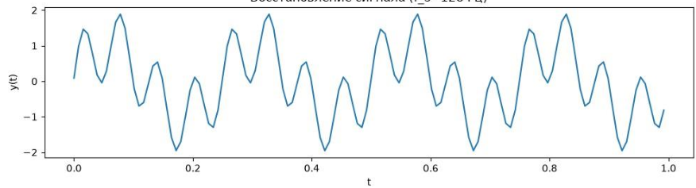
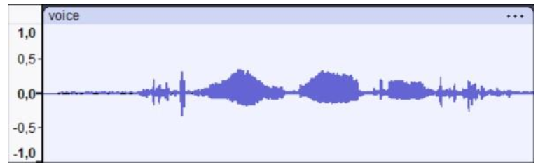
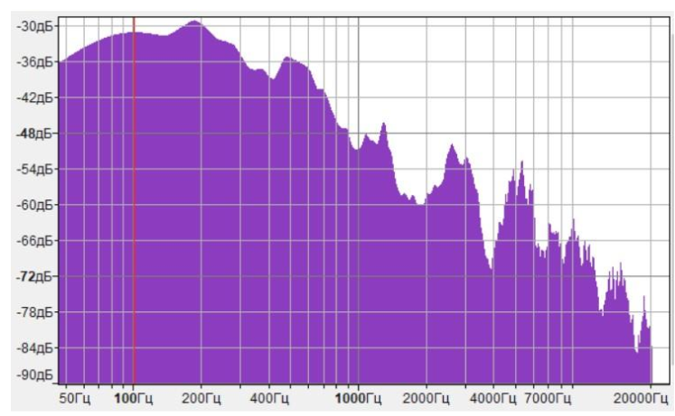
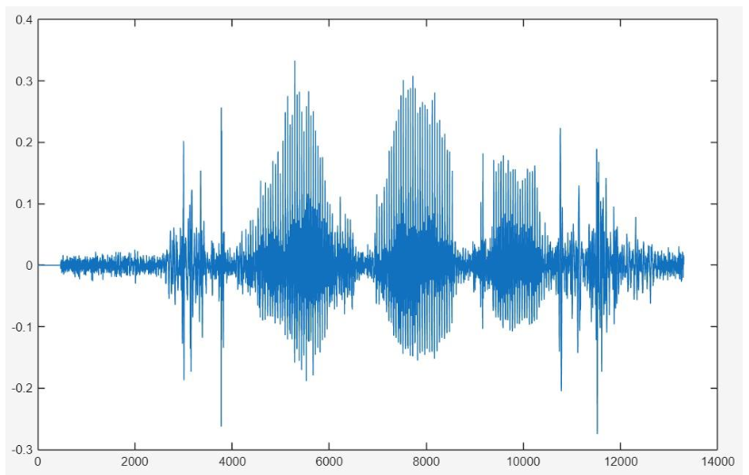
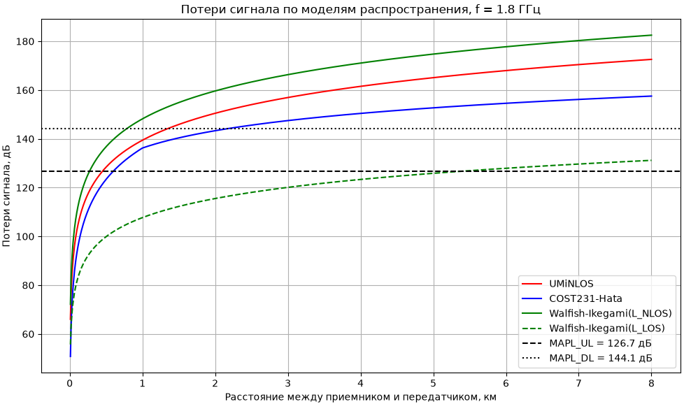
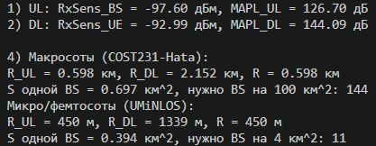

# Лабораторная работа №1: Временная и частотная формы сигналов. Преобразования Фурье. Дискретизация сигналов

## Исходные данные

- Сигнал по варианту:

$$
y(t) = \sin\left(2\pi f t + \frac{\pi}{36}\right) + \sin(8\pi f t)
$$

$$
f = 4 \text{ Гц}, \quad T = 1 \text{ с}
$$

- Инструменты: Python (**numpy**, **scipy**, **matplotlib**), MATLAB, Audacity

## Файлы

**1.py** - пункты 1-7 и 13

**script.m** - пункты 9-13

**images/lab1/** - скриншоты результатов

## Ход работы

### 1. Сигнал по варианту (пп. 1-3)

Построен непрерывный сигнал. Он состоит из двух гармоник: 4 Гц и 16 Гц, поэтому максимальная частота в спектре:

$$
f_{\max} = 16 \text{ Гц}
$$

По теореме Котельникова частота дискретизации должна превышать удвоенную максимальную. Выбрана ближайшая целая частота:

$$
f_{\text{д}} > 2 f_{\max} = 32 \text{ Гц}, \qquad f_{\text{д}} = 33 \text{ Гц}
$$

### 2. Оцифровка с f_д = 33 Гц (пп. 4-6)

33 отсчёта на 1 с, массив **float64**. Память для хранения:

$$
33 \cdot 8 = 264 \text{ байт}
$$

Ширина спектра:

$$
0 - \frac{f_{\text{д}}}{2} = 0 - 16{,}5 \text{ Гц}
$$

Разность максимального и минимального значений массива: 3,8264.

### 3. Оцифровка с f_д = 132 Гц (п. 7)

Частота увеличена в 4 раза:

$$
f_{\text{д}} = 4 \cdot 33 = 132 \text{ Гц}
$$

132 отсчёта, память и ширина спектра:

$$
132 \cdot 8 = 1056 \text{ байт}, \qquad 0 - 66 \text{ Гц}
$$

Разность максимального и минимального значений: 3,8264. Восстановленный сигнал визуально близок к оригиналу.

### 4. Запись голоса (п. 8)

Голос записан в Audacity. Максимальная частота по графику - около 20 кГц, значит:

$$
f_{\text{д}} > 2 \cdot 20 = 40 \text{ кГц}
$$

Запись сделана с частотой 48 кГц.

### 5. Чтение файла и частота дискретизации (пп. 9-10)

В MATLAB: **[y, Fs] = audioread('voice.wav')**, частота дискретизации из файла:

$$
F_s = 48000 \text{ Гц}
$$

Расчёт как отношение числа отсчётов к длительности записи (2,771 с):

$$
F_s = \frac{N}{t} \approx 48004 \text{ Гц}
$$

### 6. Прореживание (п. 11)

**y1 = downsample(y, 10)**, новая частота дискретизации и частота Найквиста:

$$
\frac{F_s}{10} = 4800 \text{ Гц}, \qquad \frac{4800}{2} = 2400 \text{ Гц}
$$

Если воспроизводить **y1** с исходной частотой **Fs**, звук искажается.

### 7. Спектры оригинала и прореженного сигнала (п. 12)

Построены амплитудные спектры через **fft**.

### 8. Влияние разрядности АЦП (п. 13)

Отсчёты сигнала варианта (f_д = 132 Гц) округляются до числа уровней:

$$
2^b - 1
$$

Для 3 бит это 0-7.

# Лабораторная работа №2: Бюджет канала связи и модели распространения сигнала

## Исходные данные

- Мощность передатчика БС: $P_{BS} = 46$ дБм
- Мощность передатчика UE: $P_{UE} = 24$ дБм
- Усиление антенны БС: $G_{BS} = 21$ дБи
- Потери в фидере: $L_{feeder} = 2 + 0.4 + 0.5 = 2.9$ дБ
- Выигрыш MIMO 2×2: $G_{MIMO} = 3$ дБ
- Запас на интерференцию: $IM = 1$ дБ
- Запас на проникновение: $L_{pen} = 15$ дБ
- Несущая частота: $f = 1800$ МГц ($1.8$ ГГц)
- Полоса UL: $BW_{UL} = 10$ МГц, полоса DL: $BW_{DL} = 20$ МГц
- Коэффициент шума БС: $NF_{BS} = 2.4$ дБ, UE: $NF_{UE} = 6$ дБ
- Требуемое SINR: $SINR_{UL} = 4$ дБ, $SINR_{DL} = 2$ дБ
- Высота антенны БС: $h_{BS} = 30$ м, UE: $h_{ms} = 1.5$ м
- Площадь макросот: $S_{macro} = 100$ км², микросот: $S_{micro} = 4$ км²
- Инструменты: Python (**numpy**, **matplotlib**)

## Файлы

**lab2.py** - расчёт бюджета канала, радиуса соты и построение графиков

**images/lab2/** - скриншоты результатов

## Ход работы

### 1. Бюджет восходящего канала (UL)

Тепловой шум в полосе UL:

$$N_{UL} = -174 + 10 \cdot \log_{10}(BW_{UL}) = -174 + 70 = -104 \text{ дБм}$$

Чувствительность приёмника БС:

$$RxSens_{BS} = NF_{BS} + N_{UL} + SINR_{UL} = 2.4 - 104 + 4 = -97.6 \text{ дБм}$$

Максимально допустимые потери:

$$MAPL_{UL} = P_{UE} - L_{feeder} + G_{BS} + G_{MIMO} - IM - L_{pen} - RxSens_{BS} = 126.7 \text{ дБ}$$

### 2. Бюджет нисходящего канала (DL)

Тепловой шум в полосе DL:

$$N_{DL} = -174 + 10 \cdot \log_{10}(BW_{DL}) = -174 + 73 = -101 \text{ дБм}$$

Чувствительность приёмника UE:

$$RxSens_{UE} = NF_{UE} + N_{DL} + SINR_{DL} = 6 - 101 + 2 = -93 \text{ дБм}$$

Максимально допустимые потери:

$$MAPL_{DL} = P_{BS} - L_{feeder} + G_{BS} + G_{MIMO} - IM - L_{pen} - RxSens_{UE} = 144.1 \text{ дБ}$$

### 3. Модели распространения сигнала

Построены зависимости потерь $PL(d)$ от расстояния для трёх моделей.

**UMiNLOS** (Urban Micro Non-Line-of-Sight):

$$PL(d) = 26 \cdot \log_{10}(f_{\text{ГГц}}) + 22.7 + 36.7 \cdot \log_{10}(d_{\text{м}})$$

**COST-231 Hata** (диапазон 1500-2000 МГц, $A = 46.3$, $B = 33.9$):

$$PL(d) = A + B \cdot \log_{10}(f) - 13.82 \cdot \log_{10}(h_{BS}) - a(h_{ms}) + s \cdot \log_{10}(d_{\text{км}}) + L_{clutter}$$

где 

$$a(h_{ms}) = 3.2 \cdot [\log_{10}(11.75 \cdot h_{ms})]^2 - 4.97$$

для городской застройки.

**Walfish-Ikegami** (LOS и NLOS):

$$L_{LOS} = 42.6 + 20 \cdot \log_{10}(f) + 26 \cdot \log_{10}(d)$$

$$L_{NLOS} = L_0 + \max(L_1 + L_2, 0), \quad L_0 = 32.44 + 20 \cdot \log_{10}(f) + 20 \cdot \log_{10}(d)$$

### 4. Радиус соты и количество базовых станций

Радиус находится аналитически из уравнения $MAPL = PL(R)$:

$$R = 10^{\frac{MAPL - C}{K}}$$

Площадь одной соты (3 сектора) и количество БС:

$$S = 1.95 \cdot R^2, \qquad N = \left\lceil \frac{S_{total}}{S} \right\rceil$$

**Результаты:**

